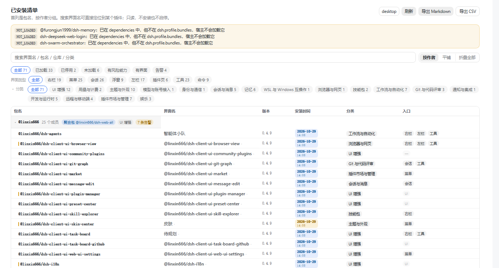
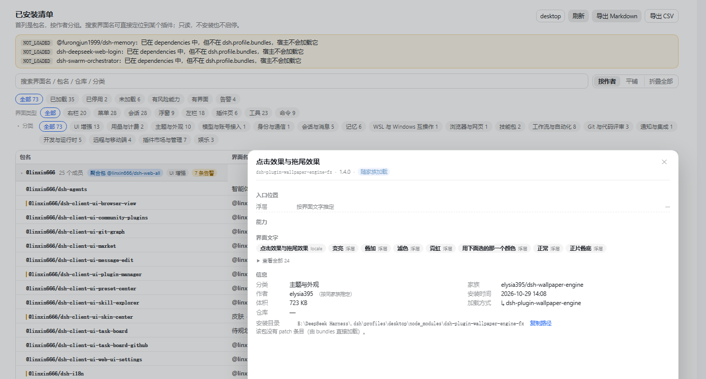

# dsh-installed-inventory

DeepSeek Harness 的「已安装插件清单」插件：把**界面显示名 ↔ npm 包名 ↔ 仓库 ↔ 启停状态 ↔ 安装时间 ↔ 入口能力**对齐到一张表，并做只读审计。

> 解决的痛点：设置页只显示中文名、插件页只显示包名、仓库信息没人看。你想知道「起子插件设置」是哪个包、装了几份、`cordis.patch.yml` 里还剩几条死条目 —— 现在一屏就能看到。



*插件页 →「已安装清单」标签：顶部三层筛选（状态 / 界面类型 / 市场分类，分类可折叠），表格首列即包名，行按作者分组，第四列是安装时间，底部三段式分页。*



*点任意一行，详情贴右侧打开：入口落在哪个界面位置、包里有哪些能力、作者（含「按同家族推定」标注）、安装时间与安装目录。*

## 它做什么

- **首列就是包名**：`@linxin666/dsh-client-ui-browser-view` 一眼可见；第二列才是界面名（中文标题），并标出名字是从 locale / manifest / bundle / 包名兜底哪一级取的
- **按作者分组**：同一位作者的组件收在一组（`@linxin666` 25 个成员、聚合包 `dsh-web-all`），组头可逐个折叠，右上角一个按钮可「折叠全部 / 展开全部」
- **市场同款分类**：AGI 架构探索 / UI 增强 / 用量与计费 / 主题与外观 / 模型与账号接入 / 身份与通信 / 会话与消息 / 记忆 / 工具与能力 / WSL 与 Windows 互操作 / 浏览器与网页 / 视觉与多模态 / 语音与音频 / 文档与渲染 / 技能包 / 工作流与自动化 / Git 与代码评审 / 通知与集成 / 开发与运行时 / 安全与权限 / 远程与移动端 / 插件市场与管理 / 娱乐 —— 「▾ 分类」整块折叠；折叠后只留一行入口，右侧显示分类个数
- **安装时间列（双行徽章）**：原「状态」列改成安装时间 —— 上行日期 `2026-10-29`、下行时间 `14:08`，徽章的底色与字色仍是原来那套状态配色（绿=已启用 / 蓝=随家族加载 / 红=未加载 / 黄=已停用），鼠标悬停显示状态文字。时间和状态一列看全，不再二选一。时间取包目录的创建时间（`npm install` 建目录那一刻），拿不到才回落 mtime
- **按安装时间排序（分组级）**：点「安装时间」表头循环三态 —— 默认（原名序）→ ▼ 最新在前 → ▲ 最早在前。排序作用在**作者分组**上：一个家族按它最晚装的成员排名次，套件今天装、整组就顶上去；组内成员保持名字顺序。平铺视图下则直接对行排序
- **分页（市场同款排版）**：底栏分三段 —— 左「共 71 条」、中「‹ 上一页 1 2 3 4 下一页 ›」、右「第 1 / 4 页 · 每页 20/40/100」。页码超过 7 页自动折叠为 `1 … 8 9 10 …`
- **返回顶部**：每页超过 20 条，或列表已经向下滚过 240px 时，表格右下角出现圆形 ↑，平滑回到列表顶部；换页 / 换筛选自动回到顶部
- **表头吸顶**：表体内部滚动，表头与分页条不随内容滚走；行高 28，按 1440×960 窗口规划
- **搜索定位**：输入界面名、包名、仓库、分类，或**界面上真正显示的文字**即可过滤；命中的插件即使所在分组处于折叠状态也会自动展开。例：侧栏里的「起子插件设置」搜得到 `dsh-brief-sidebar` —— 这个标题是它在运行时注册的，包名和 locale 里都没有，只有 bundle 里留着字面量
- **界面文字特征**：扫包内字符串，按出现位置打标（设置菜单 / 插件页 / 侧栏 / 会话区 / 浮层 / 配置卡 / 家族设置 / locale / 文案），详情里列成徽章，前 8 个直接展开、其余折进「查看全部 N」。纯静态推断：别的插件在运行时注入给你的标签不算在你头上
- **详情面板（停靠式）**：点任意一行，详情贴在列表右半边打开 —— 顶边与表头齐平、底边与列表齐平、左边从列表 35% 处开始（包名一列始终露在外面），最窄 580px；尺寸只跟列表框架走、标题栏固定在顶部，内容多了在面板内部滚动；抽屉有最小高度（`min(430px, 100vh-150px)`），筛完只剩一条时也不会被压成一条缝；✕ / Esc / 点面板外空白都能关。入口位置分三级取证据：`slots.register` 里的字面量名字 → 检测到的槽位（标注「标签由运行时渲染」）→ 界面文字里的位置标记（标注「按界面文字推定」），不再出现明明有界面却写「没有界面入口」。作者一栏与列表始终一致：包里没写 scope、也没写 repository 的，会继承同家族作者并标注「按同家族推定」，不再出现列表有名字、详情却是「—」
- **入口矩阵**：设置菜单、插件页标签、右侧边栏、左侧栏、会话区、浮层、Agent 工具、命令、后台路由 —— 逐项标 ✓/×，并给出依据（命中的插槽名）
- **审计告警**：重复 id（区分「覆盖式停用」与真冲突）、僵尸 patch 条目、装了但没登记加载、缺仓库、版本漂移、patch 备份堆积
- **增量同步**：装完插件不用手动刷新 —— host 监听 profile 变化，前端 4 秒轮询一次极轻的 `/revision`，变了才重扫；顶部提示「新增 N 个包，重启 DSH 生效」
- **导出**：Markdown / CSV

## 它不做什么

不安装、不卸载、不启停、不写 `package.json` / `cordis.patch.yml`。所有写操作只发生在 `$DSH_HOME/storages/installed-inventory/`。

## 入口

| 位置 | 插槽 | order |
|---|---|---|
| 插件页 → 「已安装清单」标签 | `plugins.tab` | 62 |
| 插件详情页「安装信息」区块 | `plugins.detail.section` | 20 |
| 设置一级菜单（需 `standaloneSection: true`） | `settings.section` | 46 |

> `plugins.tab` 是 0.2.1 真正绘制的插槽；旧文档里写的 `settings.plugins.tab` 在本版不会渲染，这是上一轮「看不到入口」的根因。

## 列表布局（1440×960 规划）

| 区域 | 高度预算 |
|---|---|
| 标题 + 副标题 + 操作 | 44 |
| 搜索 / 视图 / 折叠全部 | 30 |
| 状态筛选 + 界面类型 + 分类（可折叠） | 74 |
| 表头（吸顶） | 28 |
| 20 行 × 28 | 560 |
| 分页条 + 脚注 | 44 |

详情抽屉的最小高度是 `min(430px, calc(100vh - 150px))`，所以筛到只剩一条时它仍然成型，而不是跟着列表缩成一条缝。

表格容器 `max-height: calc(100vh - 356px)`，超过部分在表体内滚动；切 40 / 100 时页面本身不滚动。列宽：包名 32% / 界面名 21% / 版本 7% / 安装时间 11% / 分类 12% / 入口 17%。安装时间徽章是两行文字，行高按 28 排 —— 徽章高度算进行高，不会把 20 行挤出滚动条（徽章用块级 flex，inline-flex 会撑破单元格被裁掉下半行）。

## 安装

```bash
cd "$DSH_HOME/profiles/desktop"
pnpm add file:/path/to/dsh-installed-inventory --ignore-scripts
node -e "const f='package.json',p=require('./'+f);p.dsh.profile.bundles.push('dsh-installed-inventory');require('fs').writeFileSync(f,JSON.stringify(p,null,2))"
# 重启 DSH
```

卸载时**两处都要删**（`dependencies` 与 `dsh.profile.bundles`），否则宿主启动会报缺包。

## 配置

`cordis.patch.yml` 的 `insert` 行：

| 键 | 默认 | 说明 |
|---|---|---|
| `enabled` | `true` | 总开关 |
| `routeRoot` | `/api/installed-inventory` | 必须在 `/api` 下（connection 服务鉴权） |
| `profileDir` | `""` | 空 = 跟随宿主 `profileContext` |
| `standaloneSection` | `false` | 额外挂一级设置菜单 |
| `ttlSeconds` | `300` | 缓存 TTL；文件指纹变化会立即失效 |

## HTTP 接口

均在 `/api/installed-inventory` 下，只读：

- `GET /snapshot?profile=&refresh=0|1`
- `GET /revision`
- `GET /detail?name=<包名>`
- `GET /export?format=md|csv`

`detail` 只接受清单内已有的包名，不提供任意路径读取。

## 版本历史

当前 **v0.5.0**。每一版做了什么、为什么改，见 [CHANGELOG.md](CHANGELOG.md)；仓库按 `vX.Y.Z` 打了标签，可直接切到某一版。

## 开发

```bash
node --test test/*.test.js                                  # 单测（21 个）
node "…/node_modules/@perrylink/dsh-plugin-doctor/doctor.mjs" --repo . --no-smoke --only R,K
node test/manual-scan.mjs "E:/DeepSeek Harness/.dsh/profiles/desktop"   # 真实 profile 自检
```

零构建：纯 ESM + JSDoc，`lib/*.js` 直接就是产物。react / react-dom 由宿主提供，不打进 bundle。

## 已知边界

- 能力与入口为**静态推断**（扫包内代码里的插槽字符串），不是权限模型；标签在 UI 上以「静态推断」注明。
- 分类是按名称/描述关键词的粗分，可在告警里看到依据词。
- 插件热装后清单能立刻看到，但**加载仍需重启宿主**。
